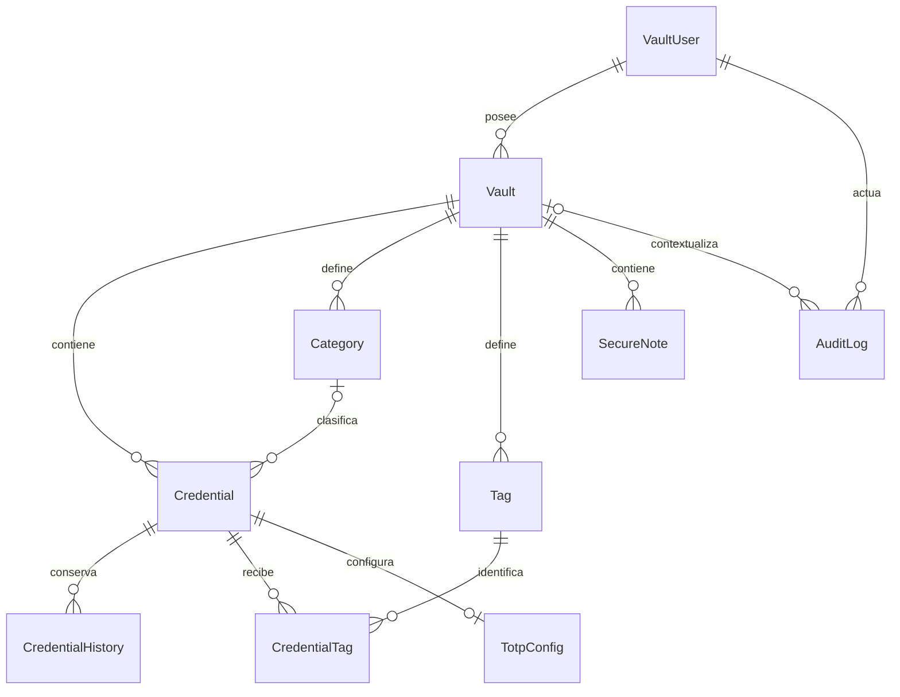

# Efest · Modelo conceptual de la bóveda académica

Cada bóveda pertenece a una identidad y define el ámbito de cifrado, clasificación y búsqueda. El diagrama muestra las cardinalidades. El diccionario precisa las columnas y los tipos de Microsoft SQL Server.

## Diccionario de entidades y atributos

**M** significa **Metadato Indexable** y **S** significa **Secreto Cifrado VARBINARY**. M incluye campos técnicos, como salt y nonce. Su clasificación indica que pueden almacenarse en claro, aunque solo los campos necesarios para cada consulta se indexan o se publican. Las columnas de tipo S contienen el cifrado y su etiqueta de autenticación. Todas las fechas se expresan en UTC.

| Entidad | Atributo | Tipo SQL Server | Clave o referencia | Obligatorio | Sensibilidad |
|---|---|---|---|---|---|
| VaultUser | user_id | UNIQUEIDENTIFIER | PK | Sí | M |
| VaultUser | login_name | NVARCHAR(128) | Único | Sí | M |
| Vault | vault_id | UNIQUEIDENTIFIER | PK | Sí | M |
| Vault | owner_id | UNIQUEIDENTIFIER | FK → VaultUser.user_id | Sí | M |
| Vault | salt | VARBINARY(16) | — | Sí | M |
| Vault | ops_limit | INT | Pasadas de Argon2id | Sí | M |
| Vault | mem_limit_kib | INT | Memoria de Argon2id en KiB | Sí | M |
| Vault | check_ciphertext | VARBINARY(MAX) | Marca de verificación cifrada | Sí | S |
| Vault | check_nonce | VARBINARY(24) | Nonce de la marca | Sí | M |
| Credential | credential_id | UNIQUEIDENTIFIER | PK | Sí | M |
| Credential | vault_id | UNIQUEIDENTIFIER | FK → Vault.vault_id | Sí | M |
| Credential | category_id | UNIQUEIDENTIFIER | FK → Category.category_id | No | M |
| Credential | title | NVARCHAR(200) | — | Sí | M |
| Credential | username | NVARCHAR(256) | — | No | M |
| Credential | url | NVARCHAR(2048) | Dirección del servicio en la ficha (RF02) | No | M |
| Credential | password_ciphertext | VARBINARY(MAX) | Contraseña vigente | Sí | S |
| Credential | nonce | VARBINARY(24) | Nonce de la contraseña vigente | Sí | M |
| CredentialHistory | history_id | BIGINT IDENTITY | PK | Sí | M |
| CredentialHistory | credential_id | UNIQUEIDENTIFIER | FK → Credential.credential_id | Sí | M |
| CredentialHistory | replaced_at | DATETIME2(3) | Fecha de sustitución | Sí | M |
| CredentialHistory | password_ciphertext | VARBINARY(MAX) | Contraseña anterior | Sí | S |
| CredentialHistory | nonce | VARBINARY(24) | Nonce de la versión anterior | Sí | M |
| Category | category_id | UNIQUEIDENTIFIER | PK | Sí | M |
| Category | vault_id | UNIQUEIDENTIFIER | FK → Vault.vault_id | Sí | M |
| Category | name | NVARCHAR(100) | Único por bóveda | Sí | M |
| Tag | tag_id | UNIQUEIDENTIFIER | PK | Sí | M |
| Tag | vault_id | UNIQUEIDENTIFIER | FK → Vault.vault_id | Sí | M |
| Tag | name | NVARCHAR(100) | Único por bóveda | Sí | M |
| CredentialTag | credential_id | UNIQUEIDENTIFIER | PK (1/2), FK → Credential.credential_id | Sí | M |
| CredentialTag | tag_id | UNIQUEIDENTIFIER | PK (2/2), FK → Tag.tag_id | Sí | M |
| SecureNote | note_id | UNIQUEIDENTIFIER | PK | Sí | M |
| SecureNote | vault_id | UNIQUEIDENTIFIER | FK → Vault.vault_id | Sí | M |
| SecureNote | title | NVARCHAR(200) | Título para el listado | Sí | M |
| SecureNote | body_ciphertext | VARBINARY(MAX) | Texto de la nota | Sí | S |
| SecureNote | nonce | VARBINARY(24) | Nonce del texto | Sí | M |
| TotpConfig | credential_id | UNIQUEIDENTIFIER | PK y FK → Credential.credential_id | Sí | M |
| TotpConfig | seed_ciphertext | VARBINARY(MAX) | Semilla TOTP | Sí | S |
| TotpConfig | nonce | VARBINARY(24) | Nonce de la semilla | Sí | M |
| TotpConfig | algorithm | NVARCHAR(16) | Algoritmo HMAC | Sí | M |
| TotpConfig | digits | TINYINT | Dígitos del código | Sí | M |
| TotpConfig | period_seconds | SMALLINT | Duración del intervalo | Sí | M |
| AuditLog | event_id | BIGINT IDENTITY | PK | Sí | M |
| AuditLog | actor_id | UNIQUEIDENTIFIER | FK → VaultUser.user_id | Sí | M |
| AuditLog | vault_id | UNIQUEIDENTIFIER | FK → Vault.vault_id | No | M |
| AuditLog | occurred_at | DATETIME2(3) | Instante del evento | Sí | M |
| AuditLog | action | NVARCHAR(16) | Acción del catálogo de auditoría | Sí | M |
| AuditLog | target_type | NVARCHAR(32) | Tipo de objeto al ocurrir la acción | Sí | M |
| AuditLog | target_id | UNIQUEIDENTIFIER | Identificador histórico del objeto | Sí | M |

## Reglas de integridad y protección

- **Clasificación en 3FN.** Cada categoría y cada etiqueta tiene una sola fila por nombre y bóveda. Una credencial admite de cero a una categoría. La PK compuesta de CredentialTag impide repetir una etiqueta en la misma credencial. Toda asignación o cambio de clasificación debe comprobar en la base de datos que ambos extremos pertenecen a la misma bóveda.
- **Desbloqueo.** El cliente valida los límites de Argon2id antes de derivar la clave. La marca cifrada permite comprobar la clave incluso en una bóveda vacía y autenticar el identificador de bóveda y los parámetros KDF como datos asociados. El salt mide exactamente 16 bytes y cada nonce, 24. Cada cifrado usa un nonce aleatorio nuevo. La contraseña maestra y la clave derivada permanecen en el cliente.
- **Cambio de contraseña.** Una transacción por credencial archiva el par cifrado y nonce vigente en CredentialHistory y lo sustituye por el nuevo par generado por el cliente. Un fallo revierte ambos cambios. La PK compartida de TotpConfig permite una única configuración por credencial.
- **Auditoría inmutable para la aplicación.** AuditLog admite inserciones. Los roles de aplicación carecen de permisos para actualizar o borrar eventos y las relaciones excluyen el borrado en cascada. Se registran `login` para el acceso de una identidad conocida, `unlock` para desbloquear una bóveda, y `create`, `update`, `reveal` y `export` para las acciones sobre objetos. Solo `login` puede carecer de bóveda. El par target_type y target_id conserva la referencia histórica al objeto incluso después de su eliminación. El evento registra identificadores, acción e instante, sin valores de credenciales.

## Vistas seguras y contrato de lectura

| Vista conceptual | Granularidad | Columnas permitidas |
|---|---|---|
| vw_CredentialSummary | Una fila por credencial, incluso sin categoría | vault_id, credential_id, title, username, url, category_id, category_name |
| vw_CredentialTagSummary | Una fila por asignación de etiqueta | vault_id, credential_id, tag_id, tag_name |
| vw_SecureNoteSummary | Una fila por nota | vault_id, note_id, title |

Los listados y búsquedas se limitan a la bóveda autorizada y emplean estas vistas con columnas explícitas. El rol de consulta recibe acceso a las vistas y carece de lectura directa de las tablas base. Cada DTO de resumen reproduce solo las columnas permitidas. RF07 busca por título y usuario y filtra por categoría y etiquetas. La URL se conserva como metadato de la ficha. La búsqueda por etiqueta filtra el resumen por la existencia de una asignación coincidente, lo que conserva una fila por credencial aunque coincidan varias etiquetas. Los índices de búsqueda se orientan al título y al usuario dentro de la bóveda, y al recorrido de CredentialTag desde la etiqueta.

Revelar una contraseña sigue una operación de acceso distinta. El cliente desbloqueado solicita una sola credencial por identificador, comprueba su ámbito autorizado, recupera su par cifrado y nonce y registra el evento. Ninguna vista de listado proyecta cargas cifradas ni parámetros criptográficos.

**Anclaje con el Spec 001.** Antes de implementar, el equipo debe aprobar y registrar la adaptación de F1 y AC1 al alta de una bóveda relacional con metadatos visibles, de AC4 a la autenticación de los datos protegidos y de AC6 a la conexión de persistencia autorizada. El diagrama cubre el alcance del curso. El límite de una credencial de F2 y las funciones posteriores requieren su propia conciliación al planificar cada incremento.
