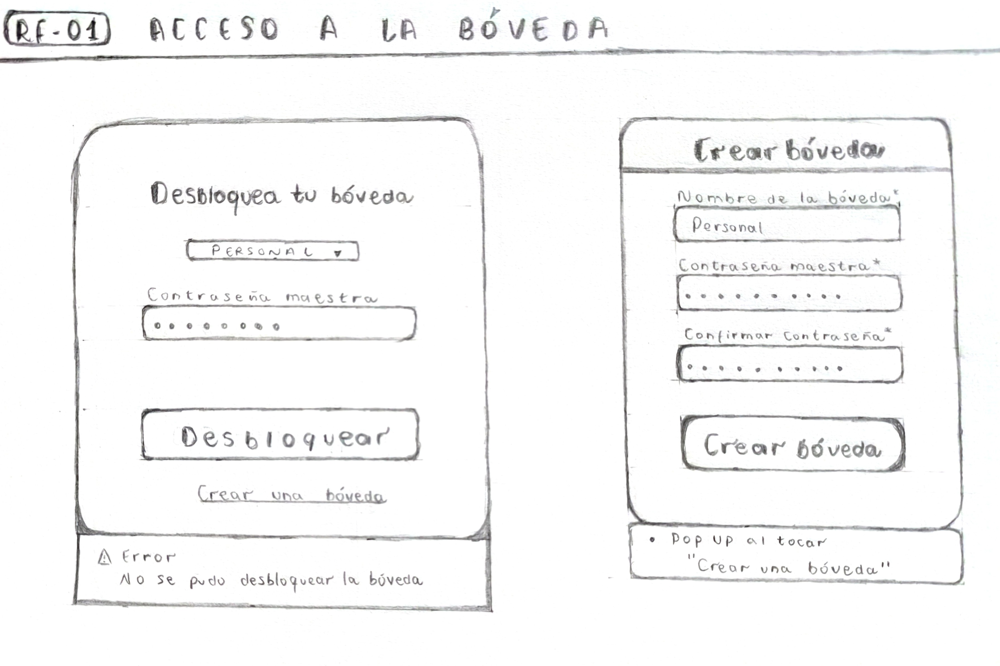
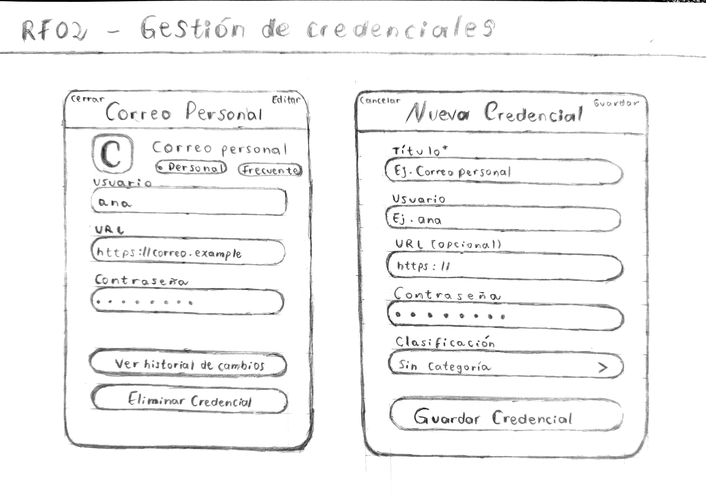
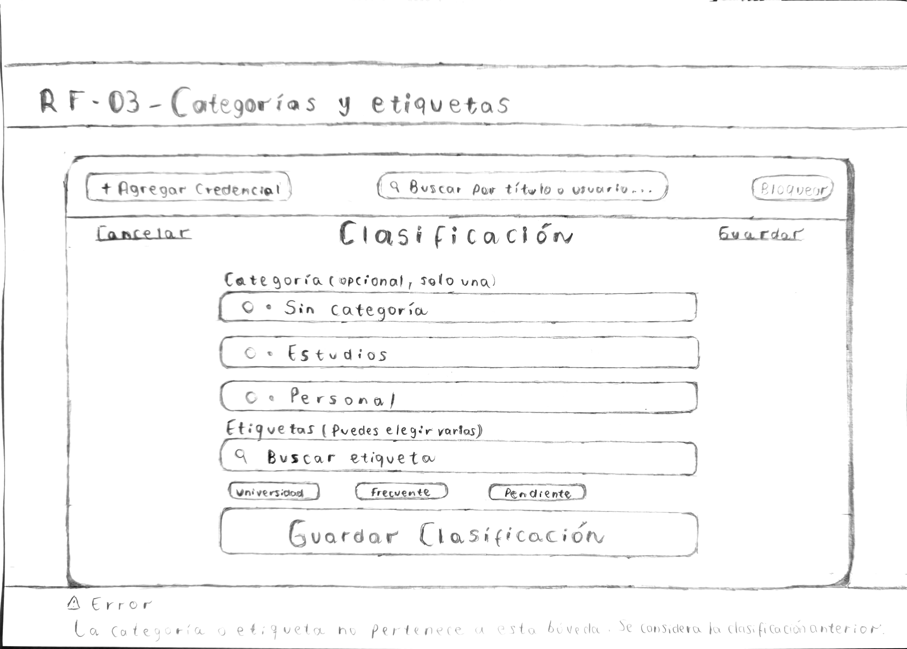
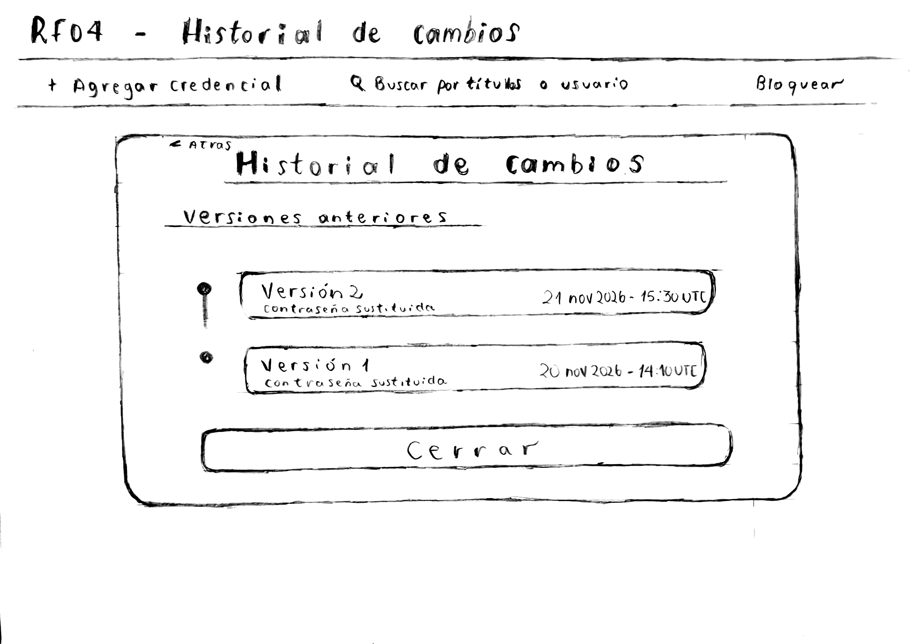
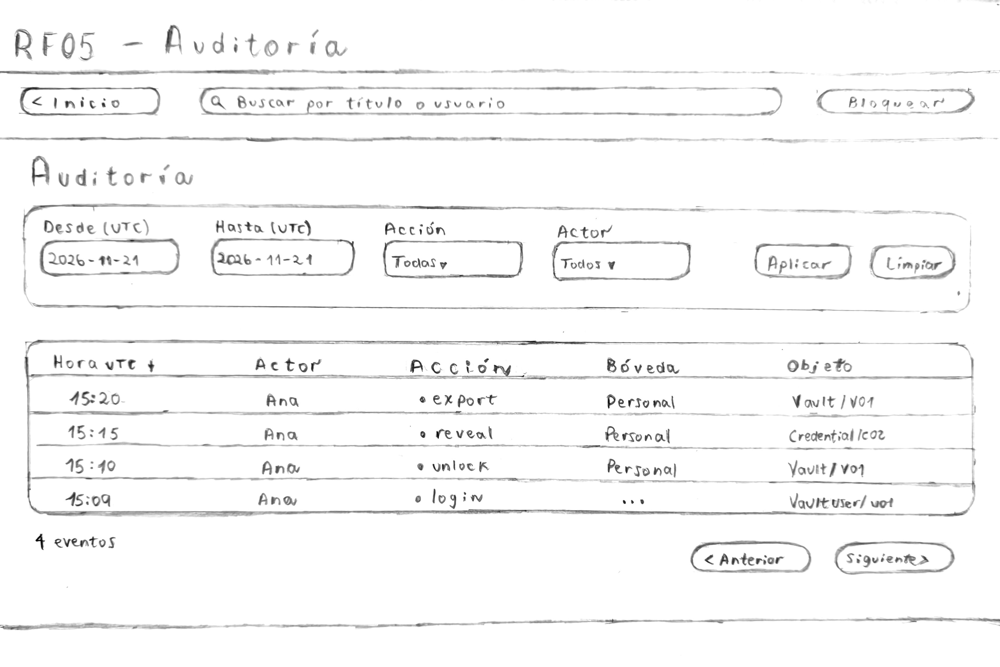
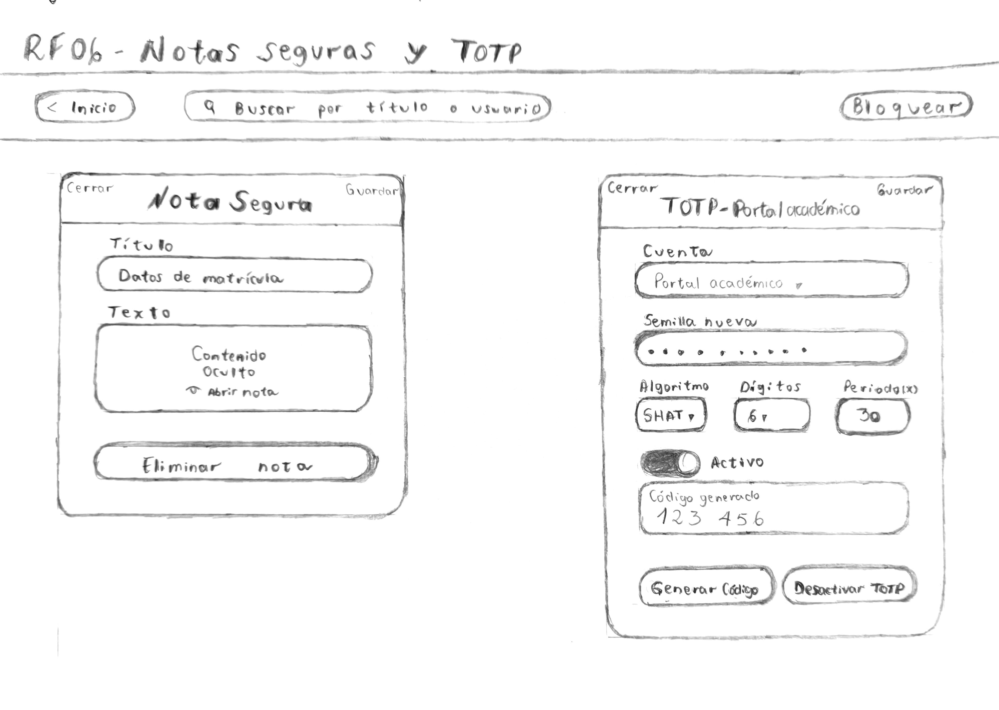
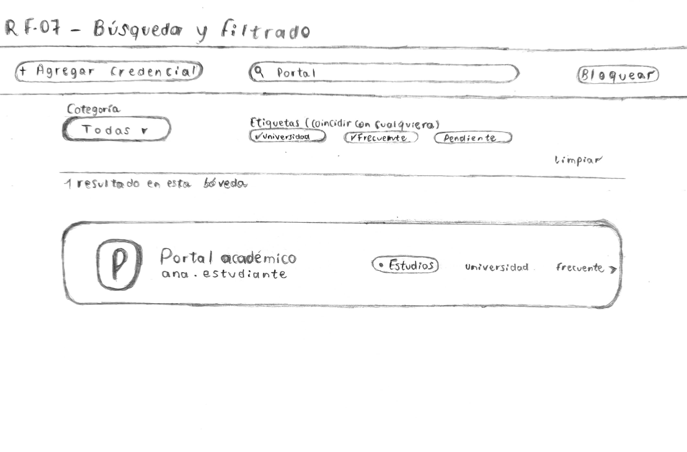
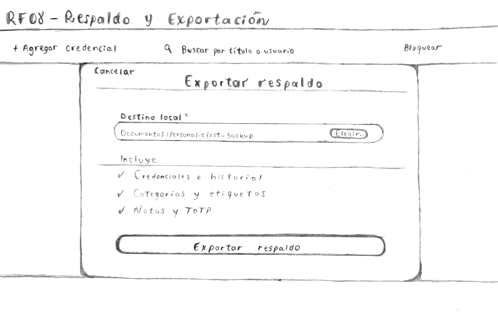

# Efest · Prototipos de baja fidelidad

Los ocho wireframes corresponden a las [historias de usuario](03-historias-usuario.md). Las claves y semillas se representan con `••••••••`. El revelado de contraseñas dura mientras se mantiene presionado el botón. Bloquear la bóveda oculta los secretos y devuelve al acceso de RF01.

## RF01 — Pantalla de creación y desbloqueo de bóveda



```text
+--------------------------------------------------------------------------+
| Bóvedas > Acceso                                  [Bloquear bóveda]      |
| Estado: Bloqueada (bloqueo ya activo)                                    |
|--------------------------------------------------------------------------|
| Mis bóvedas                      | Modo: [Desbloquear] [Crear nueva]     |
| > Personal                       | Bóveda: Personal                      |
|                                  | Contraseña maestra [••••••••]         |
|                                  | Confirmar         [••••••••]          |
|                                  | (Confirmación solo al crear)          |
|                                  | [Desbloquear] o [Crear bóveda]        |
|--------------------------------------------------------------------------|
| Estado alternativo: No se pudo desbloquear la bóveda.                    |
+--------------------------------------------------------------------------+
```

- **Componentes.** Selector de bóveda, modos de acceso, campos enmascarados y mensaje de error único.
- **Datos.** El selector muestra metadatos de `Vault`. Para la bóveda elegida, el cliente obtiene sus parámetros Argon2id y su marca de verificación cifrada. La contraseña maestra permanece enmascarada y se procesa localmente.
- **Flujo.** Elegir o crear una bóveda, validar la contraseña localmente y entrar. Bloquear purga la clave y vuelve a esta pantalla.

## RF02 — Pantalla de gestión de credenciales



```text
+--------------------------------------------------------------------------+
| Bóveda Personal > Credenciales                    [Bloquear bóveda]      |
| [Nueva credencial]                                      2 resultados     |
|--------------------------------------------------------------------------|
| Título               | Usuario          | Categoría                      |
| > Correo personal    | ana              | Personal                       |
|   Portal académico   | ana.estudiante   | Estudios                       |
|--------------------------------------------------------------------------|
| Ficha de credencial           [Editar] [Eliminar]                        |
| Título [Correo personal  ]    Usuario [ana              ]                |
| URL (opcional) [https://correo.example                   ]               |
| Contraseña [••••••••] [Mantener presionado para revelar]                 |
| En edición: [Guardar] [Cancelar]    [Ver historial de contraseñas]        |
|--------------------------------------------------------------------------|
| Confirmar eliminación: se borrarán historial, etiquetas asignadas        |
| y configuración TOTP de la credencial. [Cancelar] [Eliminar]             |
+--------------------------------------------------------------------------+
```

- **Componentes.** Ventana para consultar y editar una credencial, con control de revelado, acceso al historial y confirmación de borrado. El formulario de alta solicita título, usuario, URL opcional, contraseña y clasificación opcional.
- **Datos.** `vw_CredentialSummary` alimenta el listado. La ficha muestra la URL cuando la credencial tiene una. El cliente recupera la contraseña cifrada y el nonce de la credencial seleccionada únicamente al solicitar el revelado.
- **Flujo.** Abrir una credencial para editar sus datos o revelar su contraseña mientras se mantiene presionado el botón. Al soltarlo o bloquear la bóveda, se vuelve a enmascarar. El cambio de contraseña se gestiona desde el historial (RF04). Al confirmar la eliminación se borran el historial, las etiquetas asignadas y la configuración TOTP.

## RF03 — Modal de categorías y etiquetas


```text
+--------------------------------------------------------------------------+
| Bóveda Personal > Credenciales                    [Bloquear bóveda]      |
| > Portal académico / Editar clasificación                                |
|--------------------------------------------------------------------------|
| Categoría (opcional)   [Estudios               v]                        |
| Opciones: Sin categoría / Estudios / Personal                            |
|                                                                          |
| Etiquetas de esta bóveda      Buscar [                     ]             |
| [x] Universidad                                                          |
| [x] Frecuente                                                            |
| [ ] Pendiente                                                            |
|--------------------------------------------------------------------------|
| [Cancelar] [Guardar clasificación]                                       |
| Estado alternativo: La categoría o etiqueta no pertenece a la bóveda.    |
+--------------------------------------------------------------------------+
```

- **Componentes.** Selector de categoría única y opcional, filtro de etiquetas y selección múltiple.
- **Datos.** La categoría actual viene de `vw_CredentialSummary` y las asignaciones de `vw_CredentialTagSummary`. Los catálogos `Category` y `Tag` aportan solo metadatos de la bóveda.
- **Flujo.** Seleccionar una categoría o dejarla vacía, marcar varias etiquetas y guardar. Una asignación ajena a la bóveda conserva la clasificación previa.

## RF04 — Pantalla de cambio de contraseña e historial



```text
+--------------------------------------------------------------------------+
| Bóveda Personal > Credenciales                    [Bloquear bóveda]      |
| [Volver a la ficha] > Portal académico > Historial                       |
|--------------------------------------------------------------------------|
| Contraseña vigente [••••••••] [Mantener presionado para revelar]         |
| Nueva contraseña   [••••••••] [Guardar cambio]                           |
| Al guardar, la contraseña vigente se archiva cifrada.                    |
|--------------------------------------------------------------------------|
| Versiones anteriores   | Fecha de sustitución (UTC)                      |
| Versión 2              | 2026-11-21 15:30                                |
| Versión 1              | 2026-11-20 14:10                                |
|--------------------------------------------------------------------------|
| Estado alternativo: No se guardó el cambio. Historial intacto.           |
+--------------------------------------------------------------------------+
```

- **Componentes.** Contraseña vigente enmascarada con control de revelado, lista de versiones ordenada por fecha y formulario opcional para cambiar la contraseña.
- **Datos.** `vw_CredentialSummary` aporta el título. El historial lista solo metadatos de `CredentialHistory`. El revelado de la contraseña vigente se solicita por separado, como en RF02.
- **Flujo.** Abrir el historial desde la ficha y consultar las versiones anteriores con su fecha UTC. Guardar una nueva contraseña archiva la anterior cifrada y actualiza el historial tras confirmar la transacción. Si falla, se conserva el estado previo.

## RF05 — Pantalla de auditoría



```text
+--------------------------------------------------------------------------+
| Bóveda Personal > Auditoría                       [Bloquear bóveda]      |
| Desde UTC [2026-11-21]   Hasta UTC [2026-11-21]                          |
| Acción [Todas v]   Actor [Todos v]   [Aplicar] [Limpiar]                 |
|--------------------------------------------------------------------------|
| Hora UTC | Actor  | Acción | Bóveda   | Objeto                           |
| 15:20    | Ana    | export | Personal | Vault / v01                      |
| 15:15    | Ana    | reveal | Personal | Credential / c02                 |
| 15:10    | Ana    | unlock | Personal | Vault / v01                      |
| 15:09    | Ana    | login  | --       | VaultUser / u01                  |
|--------------------------------------------------------------------------|
| 4 eventos de solo lectura    [Anterior] [Siguiente]                      |
| Estado alternativo: Sin eventos para estos filtros.                      |
+--------------------------------------------------------------------------+
```

- **Componentes.** Filtros por periodo, actor y acción, tabla paginada y estado de solo lectura.
- **Datos.** Una consulta autorizada a `AuditLog` devuelve actor, instante, acción, bóveda y referencia histórica. Esta pantalla maneja únicamente metadatos.
- **Flujo.** Aplicar filtros y consultar eventos. Una referencia histórica permanece visible aunque se elimine la credencial correspondiente.

## RF06 — Pantalla de notas seguras y TOTP



```text
+--------------------------------------------------------------------------+
| Bóveda Personal > Notas y TOTP                    [Bloquear bóveda]      |
| [Notas] [TOTP]                                                           |
|--------------------------------------------------------------------------|
| Notas                            | TOTP por credencial                   |
| > Datos de matrícula             | Cuenta [Portal académico v]           |
| Título [Datos de matrícula]      | Semilla nueva [••••••••]              |
| Texto [Contenido oculto] [Abrir]  | Algoritmo [SHA1 v] Dígitos [6 v]     |
| [Nueva] [Guardar] [Eliminar]      | Periodo (s) [30]  Estado: Activo     |
|                                  | [Guardar configuración]               |
|                                  | [Generar código] [Desactivar]         |
|                                  | Código generado: 123456 (ejemplo)     |
|--------------------------------------------------------------------------|
| Confirmar: eliminar la nota o desactivar TOTP, según la acción.          |
| [Cancelar] [Confirmar]                                                   |
+--------------------------------------------------------------------------+
```

- **Componentes.** Paneles de notas y configuración TOTP, acciones de edición y confirmación de eliminación o desactivación.
- **Datos.** `vw_SecureNoteSummary` y `vw_CredentialSummary` aportan los listados. El texto de la nota y la semilla se recuperan cifrados por identificador al abrir la nota o generar un código.
- **Flujo.** Abrir o editar una nota. Para TOTP, seleccionar la credencial, guardar su configuración y generar el código en el cliente desbloqueado.

## RF07 — Pantalla de búsqueda y filtrado



```text
+--------------------------------------------------------------------------+
| Bóveda Personal > Credenciales > Buscar           [Bloquear bóveda]      |
| Título [portal              ]   Usuario [ana                    ]        |
| Categoría [Todas v]             Coincidir con cualquier etiqueta:        |
|                                 [x] Universidad  [x] Frecuente           |
| [Buscar] [Limpiar filtros]                                               |
|--------------------------------------------------------------------------|
| Título             | Usuario         | Categoría                         |
| Portal académico   | ana.estudiante  | Estudios                          |
|--------------------------------------------------------------------------|
| 1 resultado en esta bóveda                       [Abrir selección]       |
| Estado alternativo: Sin resultados para estos filtros.                   |
+--------------------------------------------------------------------------+
```

- **Componentes.** Filtros combinables, selector de etiquetas múltiples, tabla y estado sin resultados.
- **Datos.** `vw_CredentialSummary` proyecta los resultados. `vw_CredentialTagSummary` permite evaluar las etiquetas sin duplicar filas. El listado usa solo metadatos.
- **Flujo.** Combinar los filtros, buscar y abrir un resultado en su ficha. Una credencial aparece una vez aunque coincida con dos etiquetas.

## RF08 — Modal de respaldo y exportación


```text
+--------------------------------------------------------------------------+
| Bóveda Personal > Respaldo                        [Bloquear bóveda]      |
| Exportar respaldo de Personal                                            |
|--------------------------------------------------------------------------|
| Destino local [Documentos/Personal.efest-backup     ] [Elegir...]        |
| Contenido                   | Protección                                 |
| Credenciales e historial    | Contraseñas cifradas                       |
| Categorías y etiquetas      | Metadatos y relaciones                     |
| Notas y TOTP                | Texto y semillas cifrados                  |
|--------------------------------------------------------------------------|
| Advertencia: el respaldo incluye metadatos legibles.                     |
| Guárdalo en una ubicación de confianza.                                  |
| [Cancelar] [Confirmar exportación]                                       |
|--------------------------------------------------------------------------|
| En curso: Preparando respaldo.                                           |
| Éxito: Respaldo guardado y exportación registrada.                       |
| Error de auditoría: No se entregó el respaldo.                           |
+--------------------------------------------------------------------------+
```

- **Componentes.** Selector de destino, resumen de contenido, advertencia y estados de preparación, éxito y error.
- **Datos.** La pantalla muestra metadatos de la bóveda elegida. La ruta autorizada de exportación conserva las relaciones, parámetros y cargas cifradas en una lectura consistente. No muestra secretos en la interfaz.
- **Flujo.** Elegir el destino, confirmar y esperar el resultado. El sistema entrega el respaldo tras registrar `export` en `AuditLog`.
